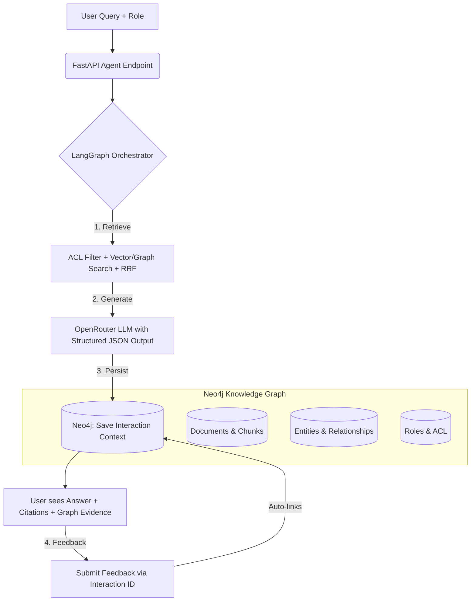

# 🧠 Self-Healing Enterprise GraphRAG Assistant

[](https://www.python.org/)
[](https://fastapi.tiangolo.com/)
[](https://neo4j.com/)
[](https://langchain-ai.github.io/langgraph/)
[](https://github.com/Parasuram19/graphrag-hitl-eval-loop/actions)

A production-ready, role-aware GraphRAG knowledge base that combines vector search, knowledge graph traversal, and Reciprocal Rank Fusion (RRF). It features a LangGraph-orchestrated agent pipeline, strict ACL filtering, and an automated Human-in-the-Loop (HITL) feedback system that links user corrections directly to the exact graph entities and chunks used in the response.

---

## 🏗️ Architecture



---

## ✨ Key Features

1. **Hybrid Retrieval**: Combines Neo4j Vector Search (`db.index.vector.queryNodes`) with Graph Traversal, fused via Reciprocal Rank Fusion (RRF) for superior context ranking.
2. **Strict ACL Enforcement**: Retrieval queries dynamically filter results based on the user's assigned roles (`user_roles`). Unauthorized documents are completely invisible to the LLM.
3. **LangGraph Orchestration**: Modular, stateful agent pipeline (`Retrieve` → `Generate` → `Save Interaction`) ensuring clean separation of concerns and robust error handling.
4. **Auto-Linked HITL Feedback**: Users submit feedback using a single `interaction_id`. The system automatically traverses the graph to link the feedback to the exact chunks, entities, and documents the agent used, enabling precise future remediation.
5. **Zero-Setup Schema Management**: The application automatically creates Neo4j constraints and vector indexes on startup, including self-healing logic to drop and recreate indexes if embedding dimensions change.
6. **CI/CD Quality Gates**: GitHub Actions workflow runs `pytest` on every push/PR to validate exception handling and prevent regressions.

---

## 🛠️ Tech Stack

- **API Framework**: FastAPI, Uvicorn, Pydantic
- **Graph Database**: Neo4j (Sandbox or Aura)
- **Orchestration**: LangGraph, LangChain Core
- **LLM Provider**: OpenRouter (supports Claude, Llama, GPT-4, etc.)
- **Embeddings**: Deterministic (default, for zero-dependency testing) or Sentence Transformers
- **Testing**: Pytest, Pytest-Mock, HTTPX

---

## 🚀 Quick Start

### 1. Prerequisites
- Python 3.10+
- A running Neo4j instance (Local Docker or Neo4j Sandbox)
- An OpenRouter API Key

### 2. Installation
```bash
# Clone the repository
git clone https://github.com/Parasuram19/graphrag-hitl-eval-loop.git
cd graphrag-hitl-eval-loop

# Create and activate virtual environment
python -m venv venv
source venv/bin/activate  # On Windows: venv\Scripts\activate

# Install dependencies
pip install -r requirements.txt
```

### 3. Environment Configuration
Create a `.env` file in the root directory:
```env
# Neo4j Connection
NEO4J_URI=bolt://localhost:7687
NEO4J_USER=neo4j
NEO4J_PASSWORD=your_password
NEO4J_DATABASE=neo4j

# Vector & Embedding
VECTOR_INDEX_NAME=chunk_embedding_384
EMBEDDING_DIMENSION=384
EMBEDDING_PROVIDER=deterministic

# OpenRouter LLM
OPENROUTER_API_KEY=sk-or-v1-your-actual-key-here
OPENROUTER_MODEL=anthropic/claude-3.5-sonnet
```

### 4. Run the Application
```bash
uvicorn app.main:app --reload
```
Visit the interactive API documentation at: [http://127.0.0.1:8000/docs](http://127.0.0.1:8000/docs)

---

## 📡 API Usage Examples

### 1. Ingest a Document
```bash
curl -X POST "http://127.0.0.1:8000/api/v1/ingest/document" \
  -H "Content-Type: application/json" \
  -d '{
    "id": "doc-1",
    "title": "Data Retention Policy",
    "content": "The Data Retention Policy is owned by the Security Team. Production data must be retained for 365 days.",
    "allowed_roles": ["Engineering", "Security"],
    "entities": [{"name": "Data Retention Policy", "kind": "Policy"}, {"name": "Security Team", "kind": "Team"}],
    "relationships": [{"source": "Data Retention Policy", "target": "Security Team", "type": "OWNED_BY"}]
  }'
```

### 2. Query the Agent (with ACL)
```bash
curl -X POST "http://127.0.0.1:8000/api/v1/agent/query" \
  -H "Content-Type: application/json" \
  -d '{
    "query": "Which team owns the data retention policy?",
    "user_id": "user-123",
    "user_roles": ["Engineering"],
    "top_k": 5
  }'
```
*Returns a structured JSON with `answer`, `confidence`, `citations`, `graph_evidence`, and a unique `interaction_id`.*

### 3. Submit HITL Feedback
```bash
curl -X POST "http://127.0.0.1:8000/api/v1/agent/feedback" \
  -H "Content-Type: application/json" \
  -d '{
    "interaction_id": "5e83fec6-a7ff-4187-9c34-364238310364",
    "feedback_type": "WRONG_ENTITY",
    "rating": -1,
    "comment": "The owner is Security Team, not Engineering.",
    "user_id": "user-123"
  }'
```
*The backend automatically links this feedback to the exact chunks and entities used in that specific interaction.*

---

## 🧪 Testing & CI/CD

The project includes robust exception handling tests to ensure production reliability.

```bash
# Run tests locally
pytest tests/ -v
```

A GitHub Actions workflow (`.github/workflows/tests.yaml`) automatically runs these tests on every push to feature branches and Pull Requests to `main`, blocking merges if exception handling or core logic regresses.

---

## 🗺️ Future Roadmap

- [ ] **Auditor Agent**: Nightly synthetic Q&A generation and negative feedback clustering.
- [ ] **Self-Healing Remediation**: Automated Cypher patch proposals (e.g., `ADD_MISSING_RELATIONSHIP`) requiring human admin approval.
- [ ] **User Personalization**: Safe, ACL-bounded user memory for response styling and frequent topic reranking.
- [ ] **Advanced Evaluation**: Integration of Ragas or TruLens for automated faithfulness and context precision scoring.

---

## 📄 License

This project is licensed under the MIT License.